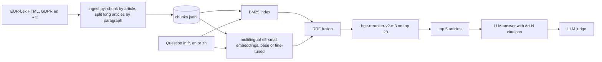

# GDPR-RAG: multilingual question answering over the GDPR, with citations

Ask a question about the GDPR in French, English or Chinese and get an answer that cites the articles it relied on, or says it cannot answer. The project is built to be measured: retrieval is evaluated with recall@k and MRR, embedding fine-tuning is evaluated on held-out articles, and the answers are scored by an LLM judge whose reliability is checked against human labels.

## RAG, explained with an apple pie

Imagine your grandmother wants to bake an apple pie, but she does not carry every recipe in her head. She has a shelf of recipe books.

- **Retrieval** is going to the shelf and pulling out the recipe cards that look relevant. Cutting the books into cards (chunking) and knowing how people describe a pie ("the one with cinnamon") matter a lot here.
- **Reranking** is her looking at the 20 cards you pulled out and keeping the five that really fit.
- **Generation** is baking by following those cards, and writing down which card each step came from.
- A good baker whose cards do not contain the recipe says "I don't have that one" instead of improvising. That is the behaviour we ask of the model, and the one we check.
- The **judge** is a neighbour who tastes the pie and checks it matches the cards. We also check that the neighbour is a reliable taster.

Here the recipe books are the 99 articles of the GDPR.

## Why this project

Legal answers have to be grounded: an unsupported statement about a deadline or an obligation is worse than no answer. The GDPR is public, officially available in English, French and Chinese-speaking users ask about it too, so it makes a good testbed for cross-language retrieval with citations. The goal is not a chat demo but a small, reproducible study of three questions: how much do hybrid search, reranking and embedding fine-tuning help, how do answers fail, and can an LLM judge be trusted to detect those failures.

## Architecture



- **Corpus:** GDPR in English and French from EUR-Lex. Each article is one chunk; articles above 350 words are split by paragraph (Article 4 is split by definition). Every chunk keeps its article number.
- **Retrieval:** BM25 (accent-stripped tokens), dense retrieval with `intfloat/multilingual-e5-small` (CPU only), Reciprocal Rank Fusion (k = 60), then `BAAI/bge-reranker-v2-m3` on the top 20 fused candidates.
- **Evaluation:** 40 hand-checked questions (20 French, 10 English, 10 Chinese), each labelled with the gold article(s). Metrics are computed at article level, so English and French chunks of the same article count as one hit, and a Chinese question retrieving the English text counts as correct.
- **Fine-tuning:** `MultipleNegativesRankingLoss` on synthetic (question, article) pairs generated by an LLM (2 French, 1 English, 1 Chinese question per chunk). Articles that are gold for any evaluation question are excluded from training, and pairs per article are capped at 12 so that Article 4 (split into many definitions) does not dominate. Hyperparameters are the defaults in `src/finetune.py` (batch size 16, max length 256, learning rate 2e-5).
- **Generation and judge:** a Gemini Flash model through the Google AI Studio free tier. The prompt asks for answers based only on the supplied articles, a citation `[Art.N]` for each claim, and an explicit refusal when the articles do not answer the question.

## Retrieval results

Same 40 questions, before and after fine-tuning the embedding model. n = 20 (fr), 10 (en), 10 (zh).

| method | language | MRR before | MRR after | R@3 before | R@3 after |
|---|---|---|---|---|---|
| bm25 | fr | 0.42 | 0.42 | 0.47 | 0.47 |
| bm25 | en | 0.29 | 0.29 | 0.20 | 0.20 |
| bm25 | zh | 0.00 | 0.00 | 0.00 | 0.00 |
| bm25 | all | 0.29 | 0.29 | 0.28 | 0.28 |
| dense | fr | 0.65 | 0.78 | 0.73 | 0.83 |
| dense | en | 0.28 | 0.51 | 0.15 | 0.50 |
| dense | zh | 0.46 | 0.60 | 0.50 | 0.60 |
| dense | all | 0.51 | 0.67 | 0.53 | 0.69 |
| hybrid (RRF) | fr | 0.62 | 0.69 | 0.65 | 0.65 |
| hybrid (RRF) | en | 0.46 | 0.52 | 0.50 | 0.60 |
| hybrid (RRF) | zh | 0.46 | 0.60 | 0.50 | 0.60 |
| hybrid (RRF) | all | 0.54 | 0.62 | 0.57 | 0.62 |
| hybrid + rerank | fr | 0.82 | 0.85 | 0.76 | 0.79 |
| hybrid + rerank | en | 0.56 | 0.67 | 0.60 | 0.70 |
| hybrid + rerank | zh | 0.71 | 0.74 | 0.73 | 0.67 |
| hybrid + rerank | all | 0.73 | 0.78 | 0.71 | 0.74 |

How to read it:

- **BM25 is identical before and after**, as it should be: it does not use the embedding model, so this confirms both runs used the same evaluation set. It scores 0.00 on Chinese questions because they share no tokens with the French and English corpus.
- **Fine-tuning helps dense retrieval in every language**: overall MRR 0.51 to 0.67, R@3 0.53 to 0.69, with the largest gain on English (MRR 0.28 to 0.51). At question level, the rank of the first gold article improved for 19 of 40 questions, worsened for 10 and was unchanged for 11.
- **After fine-tuning, plain dense retrieval beats the RRF hybrid** (MRR 0.67 vs 0.62). Before fine-tuning the hybrid was slightly ahead (0.54 vs 0.51). BM25 is the weak half of the fusion here; for Chinese it returns nothing, so the hybrid ranking is simply the dense ranking. I did not test weighted fusion.
- **The reranker gives the best results overall** (MRR 0.78 with the fine-tuned model). Its gain from fine-tuning is smaller (+0.05 vs +0.16 for dense) because it corrects ordering errors within the same 20 candidates.
- **Small samples:** English and Chinese have 10 questions each. Differences of a few points, such as the Chinese R@3 of the reranked pipeline going from 0.73 to 0.67, are within noise.

## Judge validation

I labelled 20 of the 40 generated answers by hand before looking at any judge verdict. The sample reserves up to 6 slots for questions where retrieval missed a gold article, since those are the most likely to produce unsupported answers. Two criteria, judged only against the articles actually given to the model (not against the gold labels):

- **faithful:** every claim in the answer is supported by the supplied articles. An honest "the extracts do not allow an answer" counts as faithful.
- **citation_ok:** every cited `[Art.N]` is among the supplied articles and supports the sentence it accompanies.

| criterion | agreement | Cohen's kappa | judge too strict | judge too lenient |
|---|---|---|---|---|
| faithful | 19/20 (95%) | 0.00 | 0 | 1 |
| citation_ok | 19/20 (95%) | 0.00 | 0 | 1 |

The 95% is misleading. I labelled 19 of 20 answers as correct on both criteria, so a judge that always answers "true" would score the same, and kappa of 0.00 reflects exactly that. The judge produced no negative verdict on this sample and missed the one answer I flagged (see case 2 below). What this validation shows is that the judge is not overly harsh; it does not show that the judge can catch real errors. A test with deliberately corrupted answers is the obvious next step.

## Failure cases

**1. The right paragraph never reaches the model.** Asked whether a company must appoint a data protection officer, the system answered that the extracts did not allow a conclusion, citing only the rule on a group of undertakings sharing one officer (Art. 37, paragraph 2). The refusal was honest, so it counts as faithful, but the paragraph stating when an officer is mandatory was not in the context. The same pattern appears on the cloud-provider question: the context contained only Art. 28(4), about a processor hiring another processor, not the paragraph on the controller–processor contract. Cause: long articles are split by paragraph at indexing time, and the generation step keeps only the best-ranked chunk per article number, which is not necessarily the paragraph that answers the question. Not fixed yet; the likely fix is to keep several chunks per article, or to pass the whole article.

**2. The judge accepts an unsupported answer (question q010).** For the cloud-provider question the model answered "yes, a contract is required", extrapolating from Art. 28(4). I labelled the answer unfaithful with an unsupported citation. The judge approved it, reasoning that the contract requirement was supported by the article cited. It did not notice that the paragraph concerns processors hiring other processors, not the contract the question asks about. This is the only disagreement in the 20 labelled answers, and it is the kind of subtle over-reach the judge needs to catch.

**3. Fine-tuning does not help every question.** With dense retrieval, 10 questions got worse after fine-tuning: six dropped from rank 1 to rank 2 or 3 (q011, q017, q019, q022, q027, q032), and two fell out of the top 50 chunks entirely (q029, q030). Most of the others were already ranked poorly. I have not investigated why. One possibility is a stylistic gap between the synthetic training questions and the evaluation questions; another is simple overfitting to a small training set.

## Limitations

- 40 evaluation questions, a single training run and no confidence intervals. Differences of a few points between methods are not conclusive.
- The evaluation questions were drafted with LLM assistance and their gold articles were checked against the regulation text, with some corrected during review. The training questions come from an LLM as well, so a stylistic overlap between training and evaluation questions is possible even though no article appears in both.
- Retrieval metrics are at article level. They do not check that the right paragraph was retrieved (see failure case 1).
- The judge is validated on 20 answers with one negative example (see above). Judge and generator are both Gemini models, which may make the judge more lenient toward the generator.
- The generation prompt is in French and the answer language does not always follow the question language; I saw at least one English question answered in French. This is not quantified.
- Only the GDPR is covered, in English and French. Chinese is supported only on the query side, through cross-language retrieval.

## Reproduce

Python 3.10+, a laptop CPU is enough. The embedding model (about 0.5 GB) and the reranker (about 2.2 GB) are downloaded from Hugging Face on first use. A free Google AI Studio key is needed for synthetic data, generation and judging.

```bash
pip install -r requirements.txt
export GEMINI_API_KEY="your-key"      # PowerShell: $env:GEMINI_API_KEY = "your-key"

python src/ingest.py                                   # download GDPR (en, fr), build data/chunks.jsonl
python src/evaluate.py                                 # baseline retrieval metrics
python src/synth.py                                    # synthetic training questions
python src/finetune.py                                 # fine-tune e5-small into models/e5-finetune
python src/evaluate.py models/e5-finetune finetune     # metrics after fine-tuning
python src/compare.py                                  # before/after comparison, per-question changes
python src/run_generation.py                           # answers for the 40 evaluation questions
python src/label.py                                    # label 20 answers by hand (do this before the judge)
python src/judge.py                                    # LLM judge on all answers
python src/agreement.py                                # judge vs human agreement and disagreements
python src/generate.py                                 # interactive question answering
```

If EUR-Lex blocks the automatic download, open the page in a browser, save it as HTML to `data/raw/gdpr_en.html` and `data/raw/gdpr_fr.html`, and run `ingest.py` again. Embeddings are cached per model in `data/emb_*.npy`. `models/` and `data/raw/` are not committed.

Source of the legal text: [EUR-Lex](https://eur-lex.europa.eu/eli/reg/2016/679/oj).

